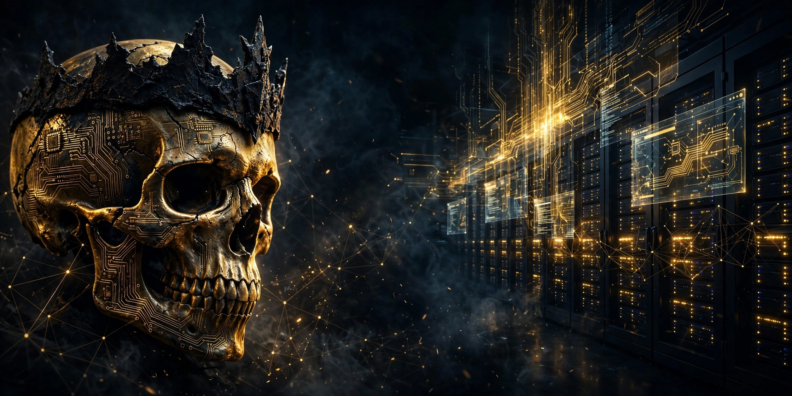

🇮🇷 [نسخه فارسی](README-fa.md)

# 🏴 ONEARMY

> One man. One mission. Zero downtime.

I'm a one-man IT army — I design, build, and run entire digital infrastructures solo: servers, automation, security, monitoring. If it's up, I built it. If it's down, I already knew.

## ⚔️ Arsenal

- 🖥️ **Infrastructure** — servers, networks, the whole backbone
- 🤖 **Automation** — if it moves, it gets automated
- 🛡️ **Security** — scanning, hardening, always watching
- 🌐 **Web at scale** — large WordPress fleets, high-traffic sites
- ⚡ **Code** — Laravel, Python, Cloudflare Workers

## 🏗️ Flagship builds

- **Dideban** — a self-sufficient monitoring & analytics platform: automated health / security / version scans, Telegram alerts, Laravel dashboard. Runs itself. I just watch.
- **Price bot** — real-time market prices on Cloudflare Workers + Telegram. Built for fun.

## 📊 Stats

---

*Built solo. Run solo. — **ONEARMY***
